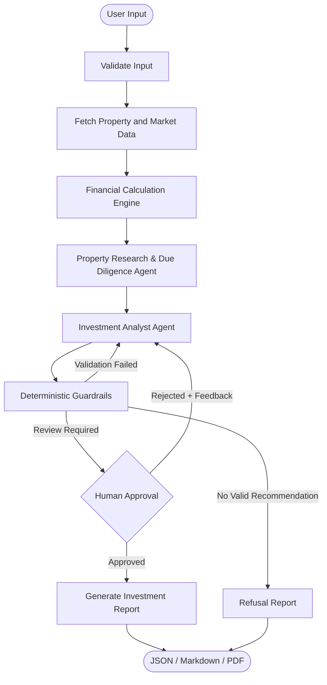

# Property AI

**An AI-powered real estate investment advisor for the Indian residential property market.**

Property AI combines financial analysis with regulatory due diligence to help investors evaluate residential properties. Given a property location, investment budget, holding period and investment strategy, it generates a **BUY, HOLD or AVOID** recommendation supported by financial calculations and references to Indian legislation and government publications.

Built with **LangGraph, Groq, ChromaDB and FastAPI**, the system uses two LLM-powered agents alongside deterministic financial calculations, validation rules and human approval.

## What it does

Evaluating a property involves more than comparing its purchase price with expected rental income. Investors also need to consider financing costs, local risks, regulatory requirements and potential changes in the market.

Property AI brings these considerations into one workflow.

- **Property analysis:** Evaluates a property using its location, budget, investment horizon and strategy.
- **Financial modelling:** Calculates rental yield, cap rate, EMI, cash flow, ROI and projected appreciation.
- **Regulatory due diligence:** Retrieves relevant provisions from Indian legislation and government publications using RAG.
- **Investment recommendation:** Produces a BUY, HOLD or AVOID decision with supporting reasoning.
- **Risk assessment:** Evaluates financial risks, missing information, conflicting evidence and regulatory concerns.
- **Human approval:** Requires an explicit approval before generating the final investment report.

## Architecture

The application is built around a LangGraph workflow. Two LLM-powered agents handle research and investment analysis, while financial calculations, validation and approval are handled by deterministic components.



### The two agents

**1. Property Research & Due Diligence Agent**

Investigates the regulatory and property-specific aspects of an investment.

It can decide which questions need further investigation and retrieve relevant information from the knowledge base. Its findings include regulatory requirements, potential concerns, evidence gaps and a due-diligence checklist.

**2. Investment Analyst Agent**

Combines the financial results, risk assessment and research findings to produce an investment recommendation.

It provides the reasoning behind its decision, along with supporting evidence, assumptions, confidence and key risks.

Both agents return structured outputs. Neither is responsible for calculating financial metrics.

### Deterministic financial engine

Financial calculations are handled separately from the LLM workflow using Python.

The engine calculates:

| Metric | Description |
|---|---|
| EMI | Monthly loan repayment |
| Gross rental yield | Annual rental income relative to property price |
| Cap rate | Net operating income relative to property price |
| Cash flow | Operating and loan-adjusted cash flow |
| ROI | Projected investment return |
| Break-even | Time required to recover the purchase price through operating cash flow |
| Stress scenarios | Impact of adverse changes in interest rates, appreciation and operating costs |

The model also evaluates scenarios such as higher interest rates, reduced appreciation, zero appreciation and increased operating expenses.

**The LLM does not calculate or modify financial figures.** It receives the calculated metrics and uses them to explain its recommendation.

## Regulatory knowledge base

The RAG pipeline uses a collection of Indian legislation and government publications stored locally in `data/`.

Some of the initial documents include:

| Document | Purpose |
|---|---|
| RERA Act, 2016 | Real estate project registration and regulatory obligations |
| Registration Act, 1908 | Registration of property-related instruments |
| Indian Easements Act, 1882 | Easements and property rights |
| Consumer Protection Act, 2019 | Consumer rights and remedies |
| Model Tenancy Act, 2021 | Model framework for tenancy regulation |
| Model Building Bye-Laws, 2016 | Building regulations and planning guidance |
| URDPFI Guidelines, 2014 | Urban and regional development planning |
| NHB RESIDEX Methodology | Residential property price index methodology |

An important distinction is maintained between binding legislation, model legislation, advisory guidelines and secondary commentary. For example, the Model Tenancy Act is not automatically binding across India; its applicability depends on state adoption.

### How retrieval works

1. Extract text from PDFs using `pypdf`.
2. Detect scanned or poorly extracted pages and apply OCR where needed.
3. Split documents into section-aware chunks while retaining page information.
4. Generate local embeddings using ChromaDB's built-in ONNX embedding model.
5. Store chunks and metadata in a persistent ChromaDB collection.
6. Retrieve relevant passages with metadata filters and generate traceable citations.

Each citation can be resolved to its source document, section, page, publisher and URL.

The ingestion pipeline also handles duplicate documents, changed files and incremental updates.

## Guardrails and human approval

LLM-generated recommendations are validated before they can reach the approval stage.

The guardrail layer checks:

- **Number grounding:** Financial figures must match deterministic calculations or retrieved evidence.
- **Citation validity:** Referenced evidence must exist in the retrieved results.
- **Financial safety:** Risk and cash-flow thresholds are evaluated independently.
- **Evidence quality:** Missing, conflicting or unsupported information is flagged.
- **Confidence:** Low-confidence recommendations require additional review.

If the research agent cannot access Groq, the workflow falls back to baseline retrieval. This degraded state is explicitly recorded and forces human review.

The workflow uses LangGraph checkpointing to preserve execution state. If a recommendation is rejected, the analyst receives the reviewer's feedback and produces a revised recommendation.

No approved investment report is generated without human approval.

## Technology stack

| Layer | Technologies |
|---|---|
| Agent orchestration | LangGraph |
| LLM | Groq, LangChain Groq |
| Backend | Python, FastAPI |
| Retrieval | ChromaDB |
| Embeddings | ONNX, all-MiniLM-L6-v2 |
| Document processing | pypdf, RapidOCR, pypdfium2 |
| Validation | Pydantic, custom deterministic guardrails |
| Reporting | ReportLab, Markdown, JSON |
| Frontend | HTML, CSS, JavaScript |
| Testing | pytest |
| Observability | JSON logging, optional LangSmith tracing |

## Project structure

```text
property-ai/
├── app.py
├── main.py
├── data/                       # Source documents
├── data_processed/             # Extracted text and ingestion manifest
├── chroma_db/                  # Persistent vector database
├── frontend/
│   └── index.html
├── scripts/
│   ├── ingest_documents.py
│   └── validate_recommendations.py
├── src/property_advisor/
│   ├── agents/
│   │   ├── research_agent.py
│   │   ├── investment_analyst_agent.py
│   │   └── _llm_utils.py
│   ├── rag/
│   │   ├── catalog.py
│   │   ├── extraction.py
│   │   ├── chunking.py
│   │   └── ingest.py
│   ├── tools/
│   │   ├── financial_calculator.py
│   │   ├── property_data_tool.py
│   │   ├── market_data_tool.py
│   │   ├── risk_data_tool.py
│   │   └── rag_tool.py
│   ├── nodes.py
│   ├── validation.py
│   ├── graph.py
│   ├── state.py
│   ├── schemas.py
│   ├── config.py
│   └── report_generator.py
├── tests/
├── evals/
├── reports/
├── requirements.txt
└── .env.example
```

## Getting started

### Prerequisites

- Python 3.11+
- A Groq API key

### Installation

```bash
git clone https://github.com/YOUR_USERNAME/property-ai.git
cd property-ai

python3.11 -m venv .venv
source .venv/bin/activate

pip install -r requirements.txt
```

Create your environment file:

```bash
cp .env.example .env
```

Add your Groq API key:

```env
GROQ_API_KEY=your_groq_api_key
GROQ_MODEL=llama-3.3-70b-versatile
```

### Build the knowledge base

```bash
python scripts/ingest_documents.py
```

This extracts, processes and indexes the source documents. The initial ingestion may take several minutes, particularly when OCR is required.

### Run the application

**Web interface and API**

```bash
python app.py
```

Open [http://localhost:8080](http://localhost:8080).

**CLI**

```bash
python main.py \
  --address "Whitefield, Bangalore" \
  --budget 9500000 \
  --horizon 5 \
  --strategy rental
```

You can also run the demo:

```bash
python main.py --demo
```

### Run tests

```bash
python -m pytest tests/ -v
```

The automated test suite uses mocked LLM and retrieval components where appropriate, so most tests can run without consuming API credits.

The live evaluation scenarios require a configured Groq API key:

```bash
python evals/run_evals.py
```

## Reports

Each completed, approved analysis generates:

- **JSON:** Structured recommendation and analysis data.
- **Markdown:** Readable investment assessment.
- **PDF:** Formatted investment report.

Reports include financial metrics, assumptions, stress scenarios, due-diligence findings, citations and data provenance.

---